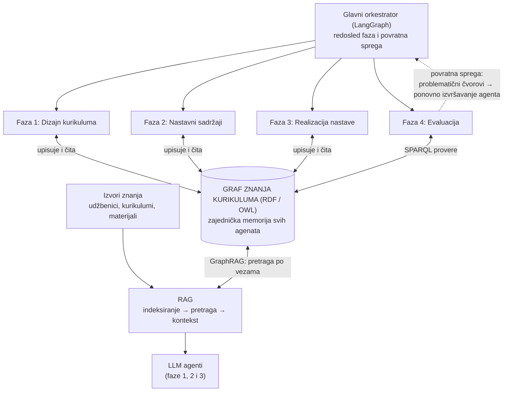
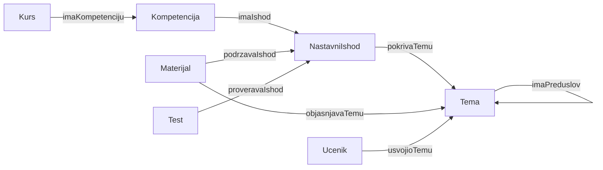

# Grafovi znanja i RAG u multiagentskim sistemima

**Pregled literature i primena na simulaciju nastavnog procesa pomoću AI agenata**

> Seminarski rad iz predmeta **Semantički veb**.
> Tema: kako se grafovi znanja (RDF / OWL / SPARQL) i RAG (*Retrieval-Augmented Generation*) mogu koristiti u multiagentskim sistemima, na primeru projekta *Simulacija nastavnog procesa pomoću AI agenata*.

---

## Sadržaj

1. [Motivacija](#1-motivacija)
2. [Teorijska osnova: grafovi i semantički veb](#2-teorijska-osnova-grafovi-i-semantički-veb)
3. [RAG i GraphRAG](#3-rag-i-graphrag)
4. [Pregled literature](#4-pregled-literature)
5. [Primena na projekat: graf i RAG u multiagentskom sistemu](#5-primena-na-projekat-graf-i-rag-u-multiagentskom-sistemu)
6. [Ontologija kurikuluma](#6-ontologija-kurikuluma)
7. [Diskusija: prednosti, rizici i ograničenja](#7-diskusija-prednosti-rizici-i-ograničenja)
8. [Zaključak i dalji rad](#8-zaključak-i-dalji-rad)
9. [Literatura](#9-literatura)
10. [Rečnik pojmova](#10-rečnik-pojmova)

---

## 1. Motivacija

Projekat simulira ceo nastavni proces kroz četiri faze, u kojima više specijalizovanih LLM agenata jedan drugome predaje rezultate:

| Faza | Naziv | Primeri agenata |
|---|---|---|
| 1 | Dizajn kurikuluma | analiza kurikuluma, kompetencije, ishodi, plan, validacija, dokumentacija |
| 2 | Nastavni sadržaji | lekcije, strategija, aktivnosti, primeri, zadaci, kvalitet |
| 3 | Realizacija nastave | scenario, nastavnik, učenici, stanje znanja, praćenje |
| 4 | Evaluacija | testovi, ocenjivanje, analize, evaluacija, optimizacija |

Ako agenti razmenjuju **samo tekst**, javljaju se dva problema:

1. **Gube se veze.** Agent za testove ne zna pouzdano koji ishod pokriva koja lekcija. Teško je proveriti celinu (ima li ishoda bez testa?), a kada evaluacija pronađe problem, nije jasno koji agent treba da ponovi posao.
2. **Jezički modeli izmišljaju.** LLM piše tečno, ali može da *halucinira* i ne poznaje konkretan nastavni materijal, pa generisane lekcije ne moraju biti tačne.

Osnovna teza ovog rada je:

> **Graf znanja služi kao zajednička memorija i alat za proveru kurikuluma, a RAG kao način da generisani sadržaj bude utemeljen u izvorima.**

---

## 2. Teorijska osnova: grafovi i semantički veb

### 2.1 Graf i trojka

Graf je skup **čvorova** (stvari) i **veza** među njima. U ovom projektu čvorovi su pojmovi iz nastave (kurs, kompetencija, ishod, tema, lekcija, test), a veze su odnosi poput „test proverava ishod“ ili „tema zahteva prethodnu temu“.

U semantičkom vebu sve se zapisuje kao **trojka** (*triple*):

```
subjekat – predikat – objekat
```

```
Test1           – proveravaIshod – Ishod1
TemaKomponente  – imaPreduslov   – TemaTypeScript
Ishod1          – imaNaziv       – "Napravi Angular aplikaciju"
```

Graf je zapravo skup ovakvih trojki. Standardni način da se graf zapiše kao trojke je **RDF** (*Resource Description Framework*).

### 2.2 URI / IRI

Svaki čvor i svaka veza imaju jedinstven identifikator, npr. `http://example.org/kurikulum#Ishod1`, kako se ne bi pomešali sa istoimenim pojmovima iz drugih izvora. U zapisu se koristi prefiks, pa se piše samo `:Ishod1`.

### 2.3 RDFS i OWL: ontologija

RDF opisuje **šta** je u grafu. **RDFS** i **OWL** opisuju **kakve vrste stvari postoje i kako smeju da se povezuju**. Takav formalni opis domena naziva se **ontologija**.

- **RDFS** daje osnovne gradivne elemente: klase, podklase, domen i opseg svojstava.
- **OWL** dodaje bogatija pravila: tranzitivna svojstva, disjunktne klase, kardinalnost i sl., što omogućava **rezonovanje** (automatsko zaključivanje).

### 2.4 SPARQL

SPARQL je za graf ono što je SQL za relacione tabele: upitni jezik u kome se zadaje šablon, a baza vraća sve što mu odgovara. Na primer: *„daj mi sve nastavne ishode za koje ne postoji nijedan test“*.

### 2.5 Alati

| Alat | Namena |
|---|---|
| **Protégé** | grafičko okruženje za modelovanje i uređivanje ontologija |
| **Apache Jena** | Java biblioteka za rad sa RDF-om, SPARQL upite i rezonovanje |
| **rdflib** | Python ekvivalent Jene; prirodniji izbor ako je sistem u Pythonu (LangGraph) |

### 2.6 Veza sa gradivom predmeta

| Predavanje | Doprinos projektu |
|---|---|
| Semantic Web Tutorial | zašto povezivati podatke u graf umesto da leže izolovani |
| Uvod u RDF | zapis znanja kao trojki |
| Osnove RDF Schema | klase i svojstva (šema grafa) |
| Razvoj ontologija | dizajn sopstvene ontologije kurikuluma |
| OWL | bogatija pravila i zaključivanje |
| SPARQL | upiti kojima agenti čitaju i proveravaju graf |
| Jena | upotreba svega navedenog iz programa |

---

## 3. RAG i GraphRAG

### 3.1 RAG

**RAG** (*Retrieval-Augmented Generation*, generisanje potpomognuto pretragom) je pristup u kome sistem, pre nego što jezički model odgovori, pronađe relevantne izvore i ubaci ih u zadatak: *„odgovori na osnovu ovoga“*. Pojam je uveden u radu Lewis et al. (2020).

Tri koraka:

1. **Indeksiranje** – dokumenti (udžbenici, postojeći kurikulumi, materijali) se dele na delove i pripremaju za pretragu. Delovi se obično pretvaraju u vektore (*embeddings*) i čuvaju u vektorskoj bazi (npr. ChromaDB).
2. **Pretraga** (*retrieval*) – za zadato pitanje pronalaze se delovi najsličniji po značenju.
3. **Generisanje** – model piše odgovor na osnovu pronađenih delova i može da navede izvor.

### 3.2 Slabost običnog RAG-a

Običan RAG pronalazi **komade teksta**, ali ne razume **veze** među njima. Pitanje *„koje sve teme moram da znam pre Angular komponenti?“* zahteva lanac preduslova, a takav lanac se teško sklapa iz nasumično pronađenih pasusa.

### 3.3 GraphRAG / KG-RAG

U **GraphRAG** pristupu pretraga ne ide samo po tekstu, već i po **grafu znanja**. Sistem pronađe čvor, pogleda njegove susede (preduslove, povezane ishode) i tek tada modelu prosledi širi, povezan kontekst. Odgovori su tačniji i **objašnjivi**, jer se vidi kojim putem kroz graf se do njih došlo (Edge et al., 2024).

| | RAG | Graf | GraphRAG |
|---|---|---|---|
| Daje | relevantan tekst | strukturu i veze | tekst + kontekst oko njega |
| Rešava | halucinacije | gubitak veza, proveru celine | oba |

> **Upozorenje iz literature:** GraphRAG nije univerzalno rešenje. Ako je graf napravljen loše (automatski, nepovezano, sa kontradikcijama), može da radi **lošije** od običnog RAG-a.

---

## 4. Pregled literature

### 4.1 MemGraphRAG – graf kao zajednička memorija više agenata

**Wu, C. et al. (2026).** *MemGraphRAG: Memory-based Multi-Agent System for Graph Retrieval-Augmented Generation.* KDD 2026. [arXiv:2606.00610](https://arxiv.org/abs/2606.00610) · [kod](https://github.com/XMUDeepLIT/MemGraphRAG)

Ovo je rad najbliži pitanju kojim se bavim: **više agenata sa zajedničkom memorijom gradi graf znanja** koji se zatim koristi za RAG.

**Problem.** GraphRAG sistemi često daju lošije rezultate od običnog RAG-a jer se graf gradi automatski iz izolovanih delova teksta. Posledica su tri vrste grešaka: nebitne činjenice, kontradiktorne činjenice i graf raspadnut na nepovezane delove.

**Rešenje – tri agenta sa podeljenim ulogama:**

1. **Extraction** – čita tekst i izvlači činjenice;
2. **Detection** – proverava da li nova činjenica protivreči postojećim;
3. **Resolution** – vraća se na originalni tekst i odlučuje koja je činjenica tačna.

**Globalna memorija u tri sloja:** ontologija (šeme), činjenice (trojke) i originalni pasusi kao dokaz. Svaka činjenica se može ispratiti do izvora.

**Probni period:** nove šeme su „kandidati“ i ulaze u graf tek kada se dovoljno puta potvrde, čime se odseca šum.

**Vrste konflikata:** međusobno isključivi (dve godine rođenja), vremenski (različite vrednosti u različitim periodima) i konflikt nivoa detalja („Šangaj“ naspram „Kina“).

**Pretraga** kombinuje sličnost po značenju i šetnju po grafu (*Personalized PageRank*); ako graf ne da dobar rezultat, sistem se vraća na običan RAG.

**Rezultati:** prosečna tačnost na pet testova je **59,25**, naspram **47,97** za običan RAG (top-5) i **57,15** za najjaču konkurentsku metodu.

**Značaj za projekat:**

- Ontologija kurikuluma odgovara njihovom **sloju šema**, a trojke **sloju činjenica**.
- Agent za **validaciju kurikuluma** radi ono što rade njihovi agenti za konflikte: traži kontradikcije i rupe (ishod bez testa, ciklus u preduslovima).
- Princip da ništa ne ulazi u graf bez provere opravdava postojanje validacionog agenta.
- Lekcija u grafu može da pamti izvor iz kog je nastala – ideja njihovog trećeg sloja.
- *Ograničenje:* rad se bavi odgovaranjem na pitanja nad velikim tekstovima, ne obrazovanjem; preuzima se princip, ne rezultati.

### 4.2 AutoGen – saradnja agenata kroz razgovor

**Wu, Q. et al. (2023).** *AutoGen: Enabling Next-Gen LLM Applications via Multi-Agent Conversation.* Microsoft. [arXiv:2308.08155](https://arxiv.org/abs/2308.08155) · [kod](https://github.com/microsoft/autogen)

Okvir u kome više LLM agenata sarađuje kroz razmenu poruka. Agenti imaju uloge i sposobnosti, mogu kombinovati LLM-ove, alate i ljudski unos, a tok razgovora se programira automatskim odgovorima ili ručno definisanim prelazima. Među primerima primene je i **RAG razgovor** (*retrieval-augmented chat*).

**Značaj za projekat:**

- Potvrđuje da je saradnja specijalizovanih agenata priznat pristup – osnova za multiagentski deo rada.
- Razgovor nastavnik–učenik (Faza 3) je upravo konverzacija dva agenta.
- Omogućava poređenje sa LangGraph-om: LangGraph je izabran jer projektu treba **strogo definisan redosled faza i povratna sprega**.
- *Ograničenje:* rad se ne bavi grafovima znanja.

### 4.3 Generative Agents – memorija agenata u simulaciji

**Park, J. S. et al. (2023).** *Generative Agents: Interactive Simulacra of Human Behavior.* Stanford / Google. [arXiv:2304.03442](https://arxiv.org/abs/2304.03442) · [kod](https://github.com/joonspk-research/generative_agents)

Simulacija malog grada sa 25 agenata. Arhitektura ima tri dela:

- **Memory stream** – dugoročna memorija iskustava u prirodnom jeziku;
- **Retrieval** – izbor relevantnih sećanja po tri kriterijuma: svežina, važnost i srodnost zadatku (kosinusna sličnost);
- **Refleksija i planiranje** – zaključci višeg nivoa iz sećanja, upisani nazad u memoriju.

Ablacije pokazuju da svaka komponenta bitno doprinosi uverljivosti ponašanja.

**Značaj za projekat:**

- Model za **agente učenike**: učenik pamti šta je čuo, odgovorio i pogrešio, i iz toga vadi relevantno – u suštini RAG nad sopstvenom memorijom.
- **Refleksija ≈ stanje znanja**: „ovaj učenik ne razume preduslove“ je zaključak višeg nivoa.
- **Predlog unapređenja:** umesto u običnom tekstu, znanje učenika se čuva kao čvorovi grafa (`usvojioTemu`), pa se zaključci proveravaju SPARQL-om.

### 4.4 Grafovi znanja i RAG u obrazovanju

| Rad | Ključna ideja |
|---|---|
| Dong, C. et al. – *How to Build an AI Tutor That Can Adapt to Any Course Using KG-RAG*, [arXiv:2311.17696](https://arxiv.org/abs/2311.17696) | AI tutor oslonjen na graf znanja kursa; autori prijavljuju napredak studenata u eksperimentu |
| *An Ontology for Representing Curriculum and Learning Material*, [arXiv:2506.05751](https://arxiv.org/abs/2506.05751) | OWL ontologija kurikuluma kao osnova za RAG – najbliže gradivu predmeta |
| *LLM-Assisted Knowledge Graph Completion for Curriculum and Domain Modelling…*, [arXiv:2501.12300](https://arxiv.org/abs/2501.12300) | LLM popunjava graf kurikuluma uz ljudsku proveru |
| *Leveraging Graph RAG to Support Learners' Understanding of Knowledge Concepts in MOOCs*, [arXiv:2505.10074](https://arxiv.org/abs/2505.10074) | edukativni graf i lični graf znanja učenika |
| *Knowledge Augmented Generation for Curriculum Planning* (Curriculum-KAG) | vektorski indeks + graf preduslova za planiranje kurikuluma |
| Abu-Salih & Alotaibi (2024), *Heliyon* 10(3) | sistematski pregled izgradnje i primene grafova znanja u obrazovanju |

### 4.5 Sinteza literature

- **Graf** u multiagentskom sistemu ima ulogu zajedničke memorije i strukture znanja (MemGraphRAG; kurikulum kao ontologija).
- **RAG** omogućava da agenti pišu na osnovu izvora (Lewis et al.), a **GraphRAG** dodaje povezan kontekst (Edge et al.).
- **Saradnja agenata** (AutoGen) i **memorija agenata** (Generative Agents) daju osnovu za arhitekturu i agente učenike.
- Zajednička poruka više radova: **kvalitet grafa je presudan** – automatski i neprovereno izgrađen graf pogoršava rezultate, pa je validacija neophodna.

---

## 5. Primena na projekat: graf i RAG u multiagentskom sistemu

### 5.1 Arhitektura



### 5.2 Tri uloge grafa

1. **Zajednička memorija** (*shared state*) – svi agenti upisuju u isti graf i čitaju iz njega. Agent za ishode upiše ishode, agent za testove ih pročita i upiše testove.
2. **Znanje o domenu** – graf zna šta su ishodi, teme, preduslovi, materijali i testovi i kako su povezani (ontologija).
3. **Alat za proveru** – SPARQL upiti rade kao automatska validacija kurikuluma, provera usklađenosti i lociranje problema u povratnoj sprezi.

### 5.3 Uloge RAG-a

- **Faza 1:** agent za analizu postojećih kurikuluma pronalazi i čita stvarne programe umesto da ih izmišlja.
- **Faza 2:** lekcije, primeri i zadaci generišu se iz pronađenih izvora – manje halucinacija.
- **Faza 3:** agent nastavnik odgovara učenicima iz materijala, a ne „iz glave“.

### 5.4 Mapiranje na agente

| Faza | Agent | Graf | RAG |
|---|---|---|---|
| 1 | Analiza postojećih kurikuluma | gradi početni graf tema i ishoda | pronalazi i čita postojeće programe |
| 1 | Kompetencije, ishodi, plan, pokazatelji | upisuje kompetencija → ishod → tema (+ preduslovi) | po potrebi |
| 1 | Validacija kurikuluma | SPARQL: svaki ishod ima pokazatelj, nema ciklusa u preduslovima | – |
| 1 | Dokumentacija | čita graf i iz njega generiše dokument | – |
| 2 | Lekcije, primeri, zadaci | uzima ishod i temu iz grafa, upisuje materijal i veze | generiše iz pronađenih izvora |
| 2 | Provera kvaliteta, organizacija | traži materijale bez veze sa ishodom | – |
| 3 | Nastavnik, učenik | stanje znanja = označeni čvorovi grafa | nastavnik odgovara iz izvora |
| 3 | Praćenje i izveštavanje | beleži događaje kao nove čvorove i veze | – |
| 4 | Testovi, ocenjivanje | test se vezuje za ishod; rezultat se upisuje | – |
| 4 | Analiza ostvarenosti, evaluacija | SPARQL: ishodi bez testa ili sa lošim rezultatom | – |
| 4 | Optimizacija i povratna sprega | iz grafa se vidi problematičan čvor → zna se koji agent ponavlja posao | – |

### 5.5 Primer toka: kurs *Uvod u Angular*

1. Korisnik zadaje kurs *Uvod u Angular*, ciljna grupa: studenti.
2. Agent za kompetencije upisuje `Komp1` (*Razvoj web aplikacija u Angularu*).
3. Agent za ishode upisuje `Ishod1` (*Napravi Angular aplikaciju*) povezan sa `Komp1`.
4. Agent za plan upisuje teme i preduslove: `TemaKomponente` zahteva `TemaTypeScript`.
5. Validacija pita graf: *ima li ishoda bez pokazatelja?* Ako ima – povratak na korak 3.
6. Agent za lekcije pita graf šta treba pokriti, pronalazi izvore (RAG), piše lekciju i upisuje je kao `Lekcija1` povezanu sa temom i ishodom.
7. U Fazi 4 agent za evaluaciju pita: *koji ishodi nemaju test?* Povratna sprega šalje zahtev agentu za testove.

---

## 6. Ontologija kurikuluma

### 6.1 Klase

`Kurs`, `Kompetencija`, `NastavniIshod`, `Tema`, `Materijal` (lekcija, primer, zadatak), `Test`, `Ucenik`

### 6.2 Svojstva

| Svojstvo | Domen | Opseg | Značenje |
|---|---|---|---|
| `imaKompetenciju` | Kurs | Kompetencija | kurs razvija kompetenciju |
| `imaIshod` | Kompetencija | NastavniIshod | kompetencija se razlaže na ishode |
| `pokrivaTemu` | NastavniIshod | Tema | ishod se ostvaruje kroz temu |
| `imaPreduslov` | Tema | Tema | tema zahteva drugu temu |
| `objasnjavaTemu` | Materijal | Tema | materijal pokriva temu |
| `podrzavaIshod` | Materijal | NastavniIshod | materijal vodi ka ishodu |
| `proveravaIshod` | Test | NastavniIshod | test proverava ishod |
| `usvojioTemu` | Ucenik | Tema | stanje znanja učenika |



### 6.3 Primer podataka (Turtle)

```turtle
@prefix :     <http://example.org/kurikulum#> .
@prefix rdfs: <http://www.w3.org/2000/01/rdf-schema#> .

:Kurs1 a :Kurs ;
    rdfs:label "Uvod u Angular" ;
    :imaKompetenciju :Komp1 .

:Komp1 a :Kompetencija ;
    rdfs:label "Razvoj web aplikacija u Angularu" ;
    :imaIshod :Ishod1, :Ishod2 .

:Ishod1 a :NastavniIshod ;
    rdfs:label "Napravi Angular aplikaciju" ;
    :pokrivaTemu :TemaKomponente .

:Ishod2 a :NastavniIshod ;
    rdfs:label "Poveže komponente servisom" ;
    :pokrivaTemu :TemaServisi .

:TemaTS         a :Tema ; rdfs:label "TypeScript osnove" .
:TemaKomponente a :Tema ; rdfs:label "Komponente" ; :imaPreduslov :TemaTS .
:TemaServisi    a :Tema ; rdfs:label "Servisi"    ; :imaPreduslov :TemaKomponente .

:Lekcija1 a :Materijal ;
    :objasnjavaTemu :TemaKomponente ;
    :podrzavaIshod  :Ishod1 .

:Test1 a :Test ;
    :proveravaIshod :Ishod1 .
```

Svaki red oblika `:A :veza :B` je jedna trojka. `Ishod2` je namerno ostavljen bez testa i bez materijala, kako bi upiti ispod imali šta da pronađu.

### 6.4 SPARQL upiti koje agenti koriste kao alate

**1) Ishodi bez testa** – agent za evaluaciju kurikuluma:

```sparql
PREFIX : <http://example.org/kurikulum#>

SELECT ?ishod WHERE {
  ?ishod a :NastavniIshod .
  FILTER NOT EXISTS { ?t :proveravaIshod ?ishod }
}
```

**2) Teme bez materijala** – agent za proveru kvaliteta:

```sparql
PREFIX : <http://example.org/kurikulum#>

SELECT ?tema WHERE {
  ?tema a :Tema .
  FILTER NOT EXISTS { ?m :objasnjavaTemu ?tema }
}
```

**3) Svi preduslovi teme, i posredni** – agent za plan i agent nastavnik (`+` = jedan ili više koraka):

```sparql
PREFIX : <http://example.org/kurikulum#>

SELECT ?pre WHERE {
  :TemaServisi :imaPreduslov+ ?pre .
}
```

**4) Ishodi jedne kompetencije sa nazivima:**

```sparql
PREFIX :     <http://example.org/kurikulum#>
PREFIX rdfs: <http://www.w3.org/2000/01/rdf-schema#>

SELECT ?ishod ?naziv WHERE {
  :Komp1 :imaIshod ?ishod .
  ?ishod rdfs:label ?naziv .
}
```

Nad primerom iz 6.3, upit 1 vraća `:Ishod2`, upit 2 vraća `:TemaTS` i `:TemaServisi`, a upit 3 vraća `:TemaKomponente` i `:TemaTS`.

---

## 7. Diskusija: prednosti, rizici i ograničenja

### Zašto graf, a ne obična baza podataka?

Graf prirodno čuva veze (preduslovi, ishod–test), podržava zaključivanje i SPARQL upite, a ontologija daje jasnu, deljenu šemu. Upit poput lanca preduslova (`imaPreduslov+`) u grafu je jedan red.

### Zašto ne samo RAG?

RAG pronalazi tekst, ali ne razume veze između delova. Pitanja o strukturi kurikuluma (lanac preduslova, pokrivenost ishoda testovima) zahtevaju strukturu koju daje graf.

### Merljivost

Cilj projekta je da istraži koliko se nastavni proces može automatizovati i kako kvalitet jedne faze utiče na ishod celine. Graf omogućava da se to **izmeri** (npr. procenat ishoda pokrivenih testovima i materijalima), a RAG da kvalitet sadržaja bude pouzdaniji.

### Rizici

- **Loš graf daje loše rezultate.** Automatski izgrađen graf može biti gori od običnog RAG-a (MemGraphRAG). Zato predlažem da se **ontologija dizajnira ručno**, a agenti je **popunjavaju i proveravaju**, uz obaveznog validacionog agenta.
- **Prenosivost rezultata.** Najrelevantniji radovi o multiagentskom GraphRAG-u ne bave se obrazovanjem – preuzimaju se principi, ne brojke.
- **Složenost.** Uvođenje grafa i RAG-a dodaje infrastrukturu (graf baza, vektorska baza, alati za upite), što treba opravdati dobitkom u kvalitetu.

---

## 8. Zaključak i dalji rad

Graf znanja i RAG rešavaju **dva različita problema** u lancu agenata:

- **graf** čuva veze i omogućava proveru celine i ciljanu povratnu spregu;
- **RAG** smanjuje izmišljanje i vezuje sadržaj za izvore;
- **GraphRAG** ih spaja: agent dobija i relevantan tekst i kontekst oko njega.

Literatura (MemGraphRAG, AutoGen, Generative Agents i radovi o KG-RAG-u u obrazovanju) potvrđuje da je ova kombinacija smislena, ali i da je kvalitet grafa ključan.

**Sledeći koraci:**

- [ ] modelovati ontologiju kurikuluma u Protégé-u;
- [ ] učitati primer iz odeljka 6.3 u Apache Jena ili rdflib i pokrenuti upite iz 6.4;
- [ ] povezati upite kao alate agenata u LangGraph orkestratoru;
- [ ] uporediti običan RAG i GraphRAG na zadatku generisanja lekcija;
- [ ] razmotriti graf bazu (npr. Neo4j) kao alternativu RDF skladištu.

---

## 9. Literatura

### RAG i GraphRAG

- Lewis, P. et al. (2020). *Retrieval-Augmented Generation for Knowledge-Intensive NLP Tasks.* NeurIPS. [arXiv:2005.11401](https://arxiv.org/abs/2005.11401)
- Edge, D. et al. (2024). *From Local to Global: A Graph RAG Approach to Query-Focused Summarization.* Microsoft Research. [arXiv:2404.16130](https://arxiv.org/abs/2404.16130)

### Grafovi i RAG u multiagentskim sistemima

- Wu, C. et al. (2026). *MemGraphRAG: Memory-based Multi-Agent System for Graph Retrieval-Augmented Generation.* KDD 2026. [arXiv:2606.00610](https://arxiv.org/abs/2606.00610)
- Wu, Q. et al. (2023). *AutoGen: Enabling Next-Gen LLM Applications via Multi-Agent Conversation.* [arXiv:2308.08155](https://arxiv.org/abs/2308.08155)
- Park, J. S. et al. (2023). *Generative Agents: Interactive Simulacra of Human Behavior.* [arXiv:2304.03442](https://arxiv.org/abs/2304.03442)

### Grafovi znanja i RAG u obrazovanju

- Dong, C. et al. *How to Build an AI Tutor That Can Adapt to Any Course Using Knowledge Graph-Enhanced Retrieval-Augmented Generation (KG-RAG).* [arXiv:2311.17696](https://arxiv.org/abs/2311.17696)
- *An Ontology for Representing Curriculum and Learning Material.* [arXiv:2506.05751](https://arxiv.org/abs/2506.05751)
- *LLM-Assisted Knowledge Graph Completion for Curriculum and Domain Modelling in Personalized Higher Education Recommendations.* [arXiv:2501.12300](https://arxiv.org/abs/2501.12300)
- *Leveraging Graph Retrieval-Augmented Generation to Support Learners' Understanding of Knowledge Concepts in MOOCs.* EMOOCs 2025. [arXiv:2505.10074](https://arxiv.org/abs/2505.10074)
- *Knowledge Augmented Generation for Curriculum Planning* (Curriculum-KAG).
- Abu-Salih, B., Alotaibi, S. (2024). *A systematic literature review of knowledge graph construction and application in education.* Heliyon, 10(3).

### Grafovi znanja i semantički veb (opšte)

- Hogan, A. et al. (2021). *Knowledge Graphs.* ACM Computing Surveys.
- W3C. [*RDF 1.1 Primer*](https://www.w3.org/TR/rdf11-primer/)
- W3C. [*OWL 2 Web Ontology Language Primer*](https://www.w3.org/TR/owl2-primer/)
- W3C. [*SPARQL 1.1 Query Language*](https://www.w3.org/TR/sparql11-query/)
- [Apache Jena – dokumentacija](https://jena.apache.org/)

---

## 10. Rečnik pojmova

| Pojam | Objašnjenje |
|---|---|
| Graf | čvorovi i veze među njima |
| Trojka (*triple*) | subjekat – predikat – objekat; jedna „rečenica“ u grafu |
| RDF | standard za zapis grafa kao skupa trojki |
| URI / IRI | jedinstveno ime čvora ili veze |
| RDFS | osnovni jezik za opis klasa i svojstava |
| OWL | bogatiji jezik za ontologije |
| Ontologija | formalni opis vrsta stvari i veza u nekoj oblasti |
| Graf znanja (KG) | graf popunjen podacima o nekoj oblasti |
| SPARQL | upitni jezik za RDF grafove |
| Rezonovanje | automatsko zaključivanje iz pravila (npr. tranzitivnost) |
| Jena | Java biblioteka za RDF, SPARQL i rezonovanje |
| rdflib | Python biblioteka za RDF i SPARQL |
| Protégé | alat za modelovanje ontologija |
| LLM | veliki jezički model |
| Halucinacija | netačna informacija koju model izmisli |
| RAG | pretraga izvora, pa generisanje odgovora na osnovu njih |
| GraphRAG / KG-RAG | RAG koji koristi i graf znanja |
| Embedding | vektorski zapis značenja teksta, za pretragu po sličnosti |
| Multiagentski sistem | više specijalizovanih agenata koji sarađuju |
| Zajedničko stanje | memorija koju dele svi agenti (ovde: graf) |
